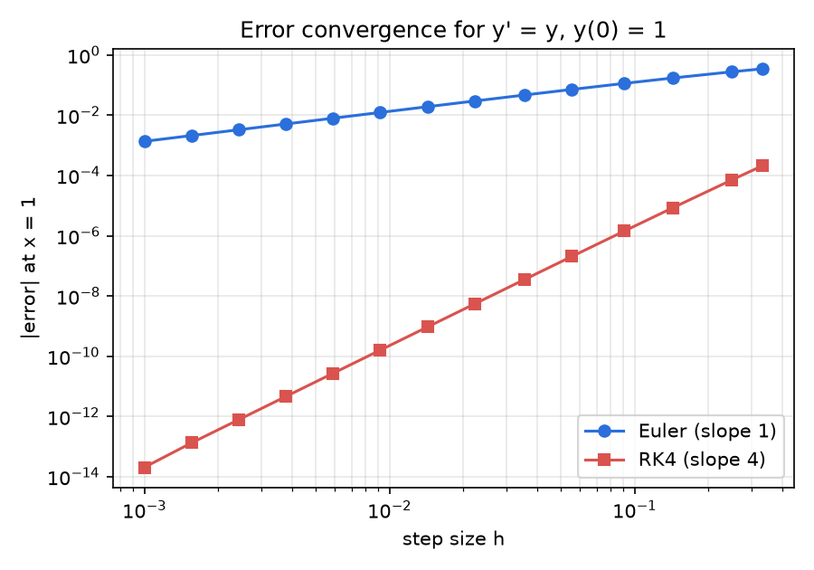

# numODEsolver


A lightweight Python package for solving first- and second-order ordinary differential equations (ODEs) numerically, using the explicit Euler method or the classical fourth-order Runge–Kutta method (RK4).

## Methods

| Method | Order of accuracy | Global error |
| :--- | :--- | :--- |
| Euler | 1st order | ∝ h |
| Runge–Kutta (RK4) | 4th order | ∝ h⁴ |

Halving the step size *h* reduces the error roughly by a factor of 2 for Euler and by a factor of 16 for RK4.


<!-- Plot the error against the exact solution of y' = y over the step size h (log-log axes).
     The slopes of 1 and 4 show the order of each method. -->

## Installation

```bash
pip install numODEsolver
```

Requires Python 3.8 or newer. Dependencies are installed automatically.
<!-- Check: list the actual dependencies here, e.g. NumPy. -->

## Usage

### First-order ODE

Solve y' = y with y(0) = 1 (exact solution: y = eˣ):

```python
import numODEsolver as ns
import matplotlib.pyplot as plt  # optional, only for plotting

solver = ns.Solver()
f = solver.get_function("y")  # right-hand side of y' = y
values = solver.rk4_1order(f, x0=0, y0=1, n=10000, bound=10.1)

print(solver.get_value(values, val=10, dec=5))  # y(10) ≈ e^10

plt.plot(values[:, 0], values[:, 1])
plt.show()
```

### Second-order ODE

Solve y'' = y' + y with y(0) = 1 and y'(0) = 1:

```python
import numODEsolver as ns

solver = ns.Solver()
f = solver.get_function("y'+y")  # right-hand side of y'' = y' + y; use y' for the first derivative
values = solver.euler_2order(f, x0=0, y0=1, dy0=1, n=10000, bound=5)

print(solver.get_value(values, val=3, dec=2))  # y(3)
```

### Parameters

| Parameter | Meaning |
| :--- | :--- |
| `x0`, `y0` | Initial point and initial value |
| `dy0` | Initial value of y' (second-order methods only) |
| `n` | Number of steps |
| `bound` | End of the integration interval |
| `val`, `dec` | x-value to evaluate and number of decimal places (`get_value`) |

### Available solvers

`euler_1order`, `rk4_1order`, `euler_2order`, `rk4_2order`
<!-- Check that these names match your code. -->

## How Functions Are Parsed

`get_function` turns a string such as `"y'+y"` into a callable function.
<!-- Explain briefly how this works and how it is made safe since v2.0
     (e.g. which expressions are allowed). -->

## Known Limitations

- Fixed step size only (no adaptive step-size control)
- Explicit methods: stiff ODEs may require very small step sizes
<!-- Add the cases where the solver currently fails or gives wrong results. -->

## Version History

| Date | Version | Changes |
| :--- | :--- | :--- |
| 19.03.2026 | v2.0 | Safer function parsing, more stable numerical methods <!-- add why the major version jump --> |
| 26.01.2025 | v0.3 | Added second-order methods |
| 15.12.2024 | v0.2 | Removed built-in plot function (use Matplotlib instead) |
| 08.12.2024 | v0.1 | First release: first-order ODEs |

## Contributing

Bug reports and suggestions are welcome. Please open an [issue](https://github.com/lukasnf/numODEsolver/issues).
<!-- Check the repository URL. -->

## Author

Lukas Filipon, B.Sc. Physics student at KIT
